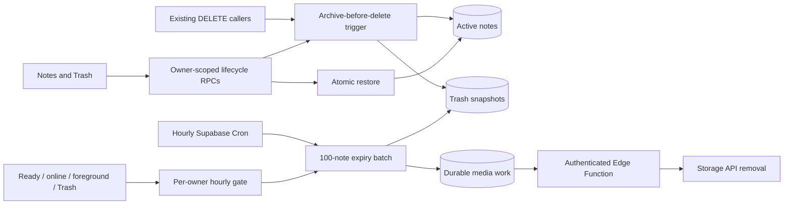

# Trash — design

Approved and implemented locally on `codex/feature-note-trash`, based on fetched `origin/main` `bd30c2716af9c2bfd39d27571133770b106e4d47`. The Stage preview and backend are deployed for PR #214; production has not been changed.

## Architecture Overview

Normal deletion atomically moves content from `public.notes` to `public.notes_trash`. Existing readers stay on `notes`, naturally excluding Trash from lists, tags, exports, FTS/AI search and privileged active-note reads. The archive-before-delete trigger protects old web/APK clients and the existing owner-filtered `delete-note` Edge endpoint. Failed archiving rolls back deletion.

Existing foreign-key cascades revoke note share links and remove vectors. Restore preserves original ID/content/tags/creation time, with a fresh update version. Sharing and paid AI indexing require explicit action after restoration.

## Data Models

- `notes_trash`: immutable `trash_id` per deletion cycle, unique original ID, owner FK/account cascade, exact content/timestamps, server deletion time, generated body bytes. RLS permits only owner SELECT; raw client writes are denied.
- Indexes: expiry `(deleted_at,trash_id)`, owner `(user_id,deleted_at DESC,trash_id)`, complete `note_share_links(note_id)` FK lookup.
- Private `operations`: content-free owner/operation/original-ID/Trash-ID receipts. They survive restore/purge so an offline lost-response replay cannot re-trash a restored note. No TTL: offline replay has no finite lifetime. Account deletion cascades receipts; monitor their size. This small ledger replaces the proposal's assumption that current lifecycle state alone was sufficient.
- Private activity tables: server-owned hourly maintenance throttles across tabs.
- `note_image_refs`: indexed references covering active and trashed notes, inaccessible to clients. Private inventory, unknown-reference markers and leased cleanup outbox contain no note bodies or credentials. Outbox work survives account deletion.

An insert guard reserves original IDs while in Trash. Note ID/owner UPDATE is rejected. Definer functions have fixed empty search paths, explicit owner checks, row locks and per-original-ID advisory locks.

## API Design

| RPC | Boundary |
| --- | --- |
| `trash_notes(p_notes)` | Owner; ≤100 entries / 32 MiB; optional complete snapshot, expected server version and durable operation ID; per-entry results. |
| `restore_notes(p_ids)` | Owner; ≤100 immutable Trash IDs; never overwrites active content. |
| `purge_notes(p_ids)` | Owner; ≤100 explicit Trash IDs; old confirmations cannot target a newer deletion cycle. |
| `cleanup_my_trash(p_run)` | Owner; one sweep/hour, ≤5 batches within a two-second run window. |
| `purge_expired_note_trash(p_owner)` | Trusted service/postgres only; ≤100 indexed candidates, `SKIP LOCKED`, one global runner. |
| `claim_trash_media_cleanup` / completion RPCs | Service only; ≤100 paths, leased acknowledgements and retry backoff. |

The client validates replies before acknowledging local deletion. New queue replays carry their stable queue ID as `operation_id`. Legacy ID-only deletion remains compatible; old clients cannot gain new local-draft safety without an update.

## Offline and UI

The durable owner-scoped queue retains complete title/HTML/tags before the active view is removed. Compaction preserves content through create/update/delete chains. Never-synced notes enter server Trash directly. Retention starts on server acceptance; pending local drafts do not expire.

Expected server versions and successful in-session save versions protect against overwriting another remote edit. Conflicts preserve local content for reconciliation. Pending Trash filters verified owner payloads before compaction; unknown legacy drafts are never merged into visible owned content. A duplicate create ID is acknowledged only after verifying identical owned remote content, never by blindly updating it.

Trash reuses the Notes sidebar, virtual list/grid cards, selection toolbar and read view. The existing layout preference is shared; on phones the note replaces the list until Back. Tags and excerpts come from the archived snapshot. Restore and Delete forever are reader actions; active note editing and sharing require restoration.

Select sits beside the layout controls in Notes and Trash. Selection uses the same row for the count, Select all and bulk actions. Done exits selection and restores the layout controls. Action labels appear when the sidebar has room. New Note and Empty Trash stay visible and are disabled during selection.

Trash loads 50 summaries per page through the security-invoker `notes_trash_list` view. It inherits the base table's owner RLS and projects at most 2,048 body characters per card. The full body is fetched only when the note is opened. Offline access is cached/read-only; restore/permanent actions require online access. The disposable owner cache holds ≤100 summaries and ≤3 full previews of ≤250,000 characters. Refresh discards removed previews; sign-out/account deletion clears that owner's reading cache without wiping the durable queue.

Single permanent deletion uses confirmation; bulk/Empty Trash reuse the exact-count dialog. Empty Trash freezes ID-only keyset pages/count before confirmation, excluding new arrivals. Select all selects loaded rows. Actions send sequential chunks of 100, prevent duplicate submission and retain failed selections. Session/request-order guards reject stale account/list/preview responses.

## Media Safety

Images remain referenced during retention and restore. Permanent note deletion queues owned files; physical removal uses the Storage API. Other active/Trash references, including cross-owner references, prevent removal. Each worker claim uses one Storage batch and one completion batch.

Legacy reference backfill processes ≤100 notes with a one-second loop budget and re-reads bodies under row locks. Unrecognized image paths, including mixed known/unknown references, conservatively block file GC while note purge still progresses. Inventory locks and per-path leases serialize new references with deletion. An uncertain Storage failure keeps the path fenced in `deleting` state with backoff; stale completion leases cannot remove newer work.

Existing public bucket URLs retain their current access model. This feature revokes note share links; bucket privacy and pre-existing orphan cleanup are separate scope.

## Scheduling and Performance

The optional schedule migration enables available `pg_cron`/`pg_net`, then schedules expiry at minute 17 hourly and media dispatch at minute 27. Vault holds the endpoint and a dedicated maintenance secret. Ordinary worker calls verify the user JWT and derive the owner; no client-supplied owner or browser service-role secret is trusted.

Expiry calls use a two-second statement timeout and 250 ms lock timeout. Cron sets the outer timeout explicitly; PostgREST hoists function timeout settings for RPCs. Activity cleanup runs asynchronously after local readiness, reconnect, foreground, Trash navigation and an hourly timer. Client throttling is only an optimization. An unrelated failed draft does not disable maintenance.

Hourly capacity is 2,400 notes/day before activity catch-up. Eligibility starts at 720 elapsed server hours. Backlogs, unavailable scheduling or paused infrastructure may delay cleanup; a monthly job could retain notes almost 60 days. No extra paid service/Cloudflare Worker is required.

The [real-migration workload](../testing/2026-11-05-note-trash-implementation-benchmark.json) covers 10,100 active notes, 1,100 Trash entries, 400 actual HNSW chunks, share links, 600 image references and 100 incompressible 256 KiB bodies on 1 CPU/512 MiB. Six committed batches removed 600 expired entries while active reads/edits ran; 10,000 remaining active notes, 500 recent Trash notes and 100 newly moved notes survived. This proves local SQL behavior, not cloud Auth/Storage/Cron execution or production latency. The earlier [proposal benchmark](../testing/2026-11-05-note-trash-benchmark.json) remains historical research.

## Trade-offs and Release Checks

Separate Trash avoids modifying every legacy/privileged reader, at the cost of copy/WAL work and explicit lifecycle locks. Retention, receipt growth and conservatively retained files consume free capacity; monitor bytes and backlog. Before production, verify project extensions/headroom, actual Cron/Storage calls, Stage timings and a rebuilt Android shell. Rollback disables maintenance while retaining Trash and archive compatibility.

Official references: [scheduling](https://supabase.com/docs/guides/functions/schedule-functions), [pg_net](https://supabase.com/docs/guides/database/extensions/pg_net), [RPC timeouts](https://supabase.com/docs/guides/database/postgres/timeouts).
