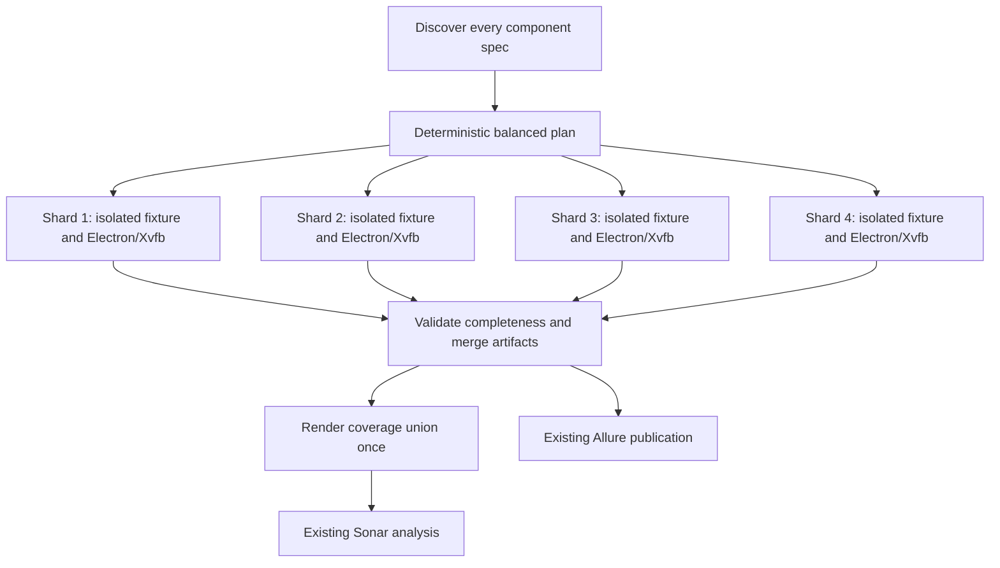

# Component Runtime Design

## Baseline and investigation

Successful run `41806363718` used one component job: 29m12s total, 27m33s in
the fixture/test step. Allure recorded 9m41s summed test duration; Cypress
reported 13m21s of spec execution. These measure different boundaries.
The configured coverage plugin invokes its report task after every spec and
generates NYC output repeatedly. Measure this separately before changing it.

`main` currently runs both Component Tests and Merge tests coverage, executing
the component suite twice. The coverage producer should call the same reusable
component workflow once, retaining Allure and Sonar consumers.

## Implemented pipeline

Each runner owns its fixture, raw results and coverage. Do not run competing
browser processes against one fixture. Disable matrix fail-fast so a failure
still leaves evidence from the remaining shards. A final stable component job
must fail if any shard or merge fails. Preserve consumers' artifact names.

Use NYC's reporter configuration to defer presentation only when the workflow
guarantees a final report step. `nyc.config.cjs` supplies an empty intermediate
reporter list for `COMPONENT_COVERAGE_DEFER_REPORT=true`; Cypress still collects
and saves counters and unvisited source placeholders through its original
tasks. The final command explicitly requests HTML/text/LCOV. Without this flag,
the plugin's original local reporting defaults remain intact.

Known Linux requirements remain: headed Electron in Xvfb, disabled JIT
compilation, real timers for queue/write barrier concurrency cases. Explicit
wait removal or connection changes require evidence that behavior remains tested.
