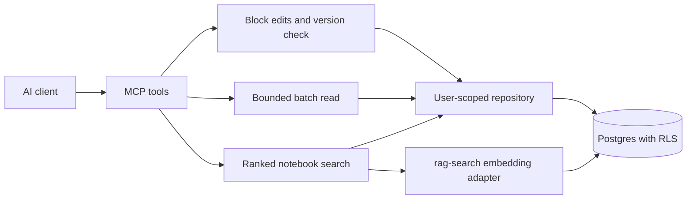

# System Design & Architecture

## Architecture Overview

## Data Models
Existing notes remain unchanged. A new invoker RPC performs compare-and-set updates against the exact `updated_at` returned by reading the note. A second invoker RPC returns note-level ranked search results using the existing embeddings; no new index data or API key is stored.

## API Design
- `update_note`: optional `content_edits` with append/prepend/insert_before/insert_after/replace; each carries `content_html` and anchored edits carry `anchor_html`. `content_html` and `content_edits` are exclusive. Edits require explicit `expected_updated_at` (including null for a legacy null timestamp). Existing full replacement may also opt into version checking.
- Edits execute sequentially against a local snapshot. Exact anchors must match once and align with complete top-level nodes. Sanitize only inserted HTML; preserve existing markup byte-for-byte. A final database compare-and-set makes the read/compute/write operation safe against concurrent writes. Missing/foreign notes share one outcome; version conflicts are distinct.
- `get_notes`: 1–50 unique ids, `format` text/html (text default), `max_chars` total body-character budget (default 100000, maximum 500000). Return one ordered result per id: ok/not_found/limit_exceeded. Never silently cut HTML or text. Single-note reading remains available for over-budget items.
- `search_notes`: query; mode text/semantic/hybrid; tags with all/any case-insensitive semantics; created_after/before and updated_after/before; sort relevance/updated_at/created_at; limit/offset; optional similarity threshold. New RPC applies ownership and filters before calculating relevance and page boundaries.
- Text relevance uses PostgreSQL web-search syntax and weighted title/body/tags. Semantic relevance uses the best chunk per note. Hybrid ranking uses reciprocal rank fusion rather than comparing incomparable raw scores. Semantic and hybrid requests reuse `rag-search` key/model handling. Hybrid setup failures return text results with an explicit warning; genuine upstream failures remain errors.

## Component Breakdown
`core/mcp/noteEdits.ts`: safe HTML edits. `core/mcp/notebookSearch.ts`: shared search schema, contracts and result mapping. `core/mcp/notebookServer.ts`: tools. `supabaseNotebookRepository.ts`: batch and RPC adapters. `ragSemanticSearch.ts` plus `rag-search`: note-search network path. One additive SQL migration owns the two RPCs.

## Design Decisions
Use complete HTML blocks instead of character offsets into mutable rich text. Require a read token for edits and execute one conditional write. Preserve legacy full-replace calls for compatibility. Limit output content instead of promising token counts. Keep text search free; do not re-embed the query for every candidate page inside a search call.

## Non-Functional Requirements
Invoker security, explicit auth.uid ownership, restricted EXECUTE grants and real two-user tests. Bound ids, edits, query, payload and pagination. Preserve exact timestamp precision; never round a version token through JavaScript Date. No measured latency promises; batch reads reduce repository round trips by construction.
