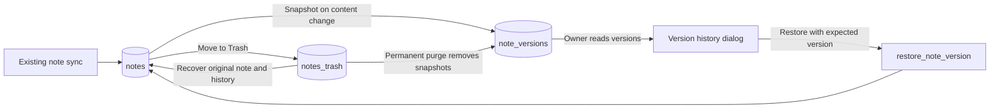

# Note version history

The note menu opens a list of dated versions with a read-only preview of the title, formatted body, and tags. The owner can restore a version. A restore that changes the note appends a snapshot, so the previous state remains available.

Snapshots start with the current state of existing active and archived notes. The PostgreSQL trigger records a changed server write in the same transaction. The restore RPC locks the active note and verifies its latest version before updating it. Row-level security limits history reads to the owner of the active note.

Moving a note to Trash preserves its snapshots. Recovering it with the same content leaves the version number unchanged. Permanent purge and account deletion remove snapshots. The existing image inventory retains references from historical bodies until permanent purge, so restoring an older snapshot can still display its images.

The local MVP lists individual server saves. The existing sync queue can combine offline edits before upload, and a later write from another device still follows the existing sync rules. Edit-session grouping and cross-device conflict handling are decisions for the full release.

The dialog keeps the editor in place and returns focus to the note menu when closed. History loads 30 version summaries at a time and fetches snapshot bodies for the selected preview or comparison. The list, preview, and comparison selectors scroll within the available space. A separate page would be useful if comparisons need their own URL or need to persist across navigation.

History is available in the note menu in both reading and editing modes. The editor keeps the draft while the dialog is open. Restoring a version requires reading mode.

The list checks for recent versions when opened, when the app regains focus, and after the server confirms a note write. Only the affected note's list refreshes. Loaded earlier pages stay in place when their boundary snapshots still match, and snapshot bodies remain cached.

After a restore, the local cache updates a synced copy only if it still matches the pre-restore copy and has no pending sync operation. The note list and search are refreshed from the server.

## Compare versions

Compare versions opens a view with two selectors, From version and To version. The initial pair uses the history selection and the current version, or the current version and its predecessor. Choosing the other field's version swaps the two selections. Load earlier versions adds more choices to both selectors.

Both Inline and Side by side read the same pair in From-to-To order. They highlight changed words, larger text blocks, and tags. Back to history returns to the selected version for formatted preview and restore. For large changes, the two-column view can display both formatted snapshots.

The inline layout follows the highlighted changes in Google Docs. Selecting two versions follows the history comparison in Confluence. [Google Workspace Learning Center](https://support.google.com/a/users/answer/9296687?hl=en) · [Confluence version comparison](https://confluence.atlassian.com/conf100/page-history-and-page-comparison-views-1627456910.html)
