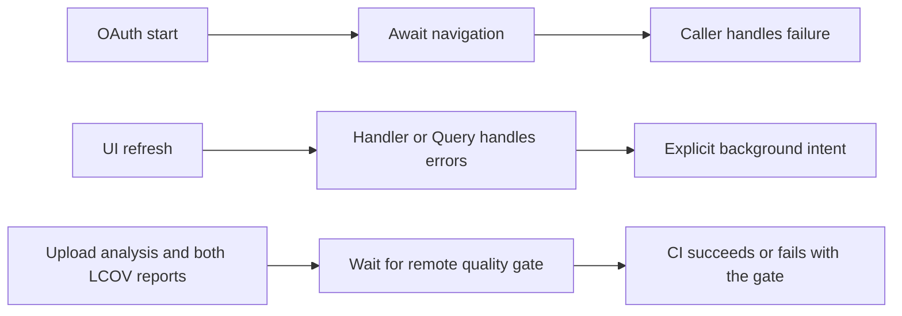

# Promise ownership and the gate boundary

NavigationAdapter permits Promise<void> or void; OAuthAdapter always returns a
promise, so its start method must await navigation. Export loading, auth
callback and the audit CLI already own their catches. TanStack Query refetches
catch fetch errors when throwOnError is false (the existing default), retain
error state, and intentionally run independently of mutation success callbacks.
Explicit void records that ownership; it does not add catch-and-ignore logic,
change query defaults, or delay saves until refetch completion.

Keep canonical CommonJS entry detection and the operator-controlled argv-list
runner unless evidence identifies a real defect. Classify confirmed analyzer
errors individually, with comments documenting the trust boundary and runtime
proof; never disable a rule or change severity to satisfy the gate.
