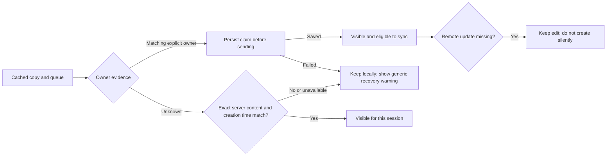

# Conservative offline cache ownership

## Scope

Filter cached notes and queued operations to the active account before display, compaction or network calls. Preserve ownerless records and remote-missing local copies rather than treating an empty RLS-filtered result as permission to delete them. A missing remote update remains queued; it is not recreated automatically. Existing known-owner create retry remains unchanged, including its existing limitations. The fallback adds a small per-owner/per-note proof key; it does not migrate or rewrite legacy arrays to a journal.

An explicit `user_id` or historical `userId` on a queued operation can associate an ownerless local copy with that account only if the operation's complete payload and timestamp match the snapshot, and no related operation or cached owner conflicts. An unrelated operation with the same ID does not establish ownership of a different cached draft or an unowned queued update. Otherwise, an ownerless copy is shown only after the authenticated server returns the same ID, complete content, tags and matching valid creation timestamp. This server proof is session-only and tied to the exact cached snapshot: a changed local record invalidates it. A different ownerless update is not authorized merely by that snapshot match. A verified copy may need online verification again after reload; a purely local, changed ownerless draft without an owner or matching original metadata cannot be attributed automatically. It remains stored and hidden, with a warning to sign in to the original account online and preserve site data. There is no automatic recovery when the necessary evidence does not exist.

Before sending an owned create/update that proves an ownerless snapshot, persist the claim. IndexedDB conditionally verifies the snapshot and queue and adds `user_id` in one transaction. The fallback writes one additive `offline_owner_claim_v1:<owner>:<note>` key with a SHA-256 digest of the content and version, after rechecking both legacy arrays. It never rewrites those arrays merely to claim ownership. A changed snapshot invalidates the digest, while a status-only transition after acknowledgement does not. The key stores a digest rather than the note's contents. If secure hashing or the write fails, no request is sent and the queue remains; the user can retry or copy the visible draft. The proof key survives acknowledgement and restart, is owner-scoped and is ignored by older clients. There is no automatic proof-key cleanup: keys can accumulate and consume origin quota. This additive format and its rollback/coexistence behavior require independent review before release.

The app displays read errors, unknown ownership, unqueued local changes and unavailable server notes in a common status area, including mobile reading, editing and Tags. Tag reconciliation retains locally saved copies missing from the server, blocks an affected operation before writes when possible, and reports uncertainty if the conflict is found after writes. A combined note count is shown only when inferable; when a local ID might be on an unloaded server page, the UI reports the number shown instead.

The unavailable-copy warning tracks IDs for the current account. A confirmed deletion or durable queued deletion clears only its IDs; failed deletions and independent queue errors remain visible. List refresh may clear a warning only for server-verified IDs and only if the warning state has not changed since that refresh began. Before reporting a missing copy, it rechecks the local snapshot so a delayed server response cannot warn about a copy deleted or edited during the request.

For tag preflight, a consistently owned foreign queue or cached draft does not block another account when tag cache patches are atomic IndexedDB transactions. An ownerless snapshot is excluded as foreign only if a related, consistently foreign operation matches its complete contents and timestamp. Conflicting, malformed or ownerless operations block with a generic account-verification message; their contents are never exposed. Pending or dirty work belonging to the current account still blocks until synchronized. The preflight is repeated after server reads and after writes; a conflict discovered after a request is reported as an unconfirmed result, not success.

The localStorage fallback rewrites a shared array rather than one record. It therefore blocks tag changes when foreign or unverified data is present, explains that another account's local data must be reviewed or an IndexedDB-capable browser used, and keeps site data. Even synchronized foreign snapshots can trigger this restriction. An empty tag patch does not rewrite the array. This safeguard is intentionally conservative and does not eliminate the fallback's existing cross-tab read-modify-write races. A new conflicting write can still start after the last check; old clients do not participate in any shared lock.

## Boundaries

- This is account isolation in the app, not encryption or protection against someone with direct access to the browser profile or site storage.
- Old open clients do not honor these checks or proof keys; localStorage read-modify-write still has cross-tab races. The separate proof key avoids overwriting a concurrent edit merely to claim it, but does not repair legacy array races. Closing or updating old clients requires a separately reviewed rollout plan. Older versions ignore the proof on downgrade, and no automatic cleanup is performed.
- The existing artificial cache limit can still evict important copies, and note/queue writes remain separate. A quota failure can leave a local copy without a queued operation. The status now warns about detectable unqueued data, but this subset does not make storage atomic or solve eviction. Browser quota is shared by the origin.
- Unchanged owned create retry may recreate a note deleted after an ambiguous earlier request or overwrite a changed server version through the existing duplicate-ID path. Eliminating that ambiguity requires a separate recovery/idempotency design; this subset does not claim to fix it.
- A source error is not equivalent to an empty store. Malformed fallback data is left intact, with an error; explicit site-data clearance can still permanently remove local-only changes.
- Session-only evidence assumes the server creation timestamp is authoritative. Matching IDs alone are insufficient. New identity evidence cannot reconstruct missing historical ownership metadata.
